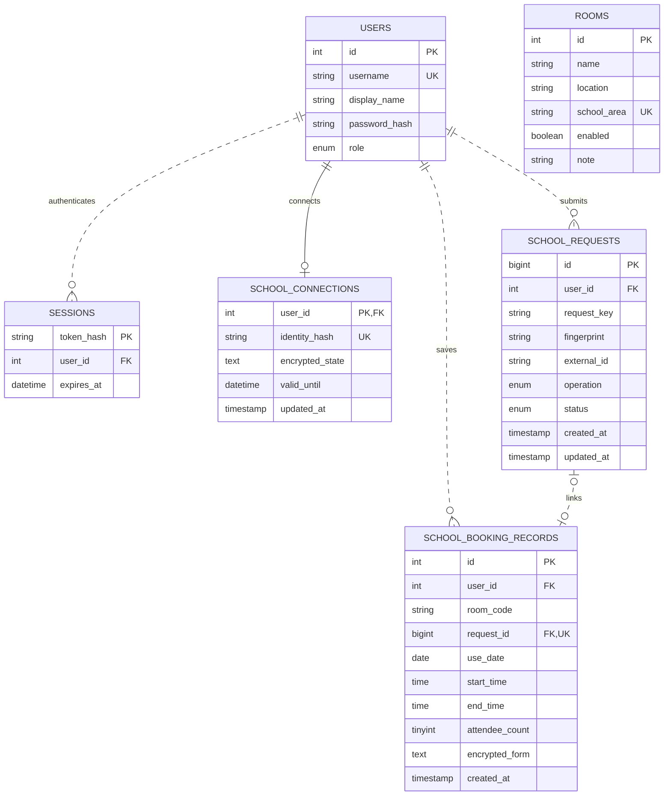

# 바로룸 교내 공간 예약의 개념 스키마

## 범위와 업무 규칙

학생은 학교 계정을 연결해 이용할 공간을 조회하고, 신청서를 임시 저장하거나 학교에 제출한다. ‘내 예약’에서 임시 저장한 신청서를 이어서 작성하거나 이전 예약으로 다시 신청할 수 있다. 앱 관리자는 학생의 임시 저장 기록을 검색하고 제2생활관 207호 미팅룸·208호 PBL강의실, 공학관 E동, TIP 3층의 임시 저장 허용 여부를 변경한다.

회원은 여러 세션과 예약 기록을 가질 수 있다. 각 세션과 예약 기록은 한 회원에게 속한다. 학생과 관리자는 회원의 역할로 구별한다.

## 엔터티와 관계형 스키마 대응

| 엔터티               | 식별자     | 주요 속성 및 제약                                              |
| -------------------- | ---------- | -------------------------------------------------------------- |
| 회원 USERS           | id         | username 중복 불가, role은 student/admin, 비밀번호는 해시 저장 |
| 로그인 세션 SESSIONS | token_hash | 회원 필수, UTC 만료 시각, 브라우저 토큰 원문 저장 금지         |
| 공간 설정 ROOMS      | id         | 구역명·위치·구역 코드·임시 저장 허용 여부. `note`는 현재 화면과 API에서 사용하지 않는 기존 컬럼 |
| 학교 계정 연결 SCHOOL_CONNECTIONS | user_id | 사용자당 최대 한 건, 학교 계정 식별값 중복 불가 |
| 학교 신청 요청 SCHOOL_REQUESTS | id | 신청·취소 처리 상태, (user_id, request_key) 조합 중복 불가 |
| 예약 기록 SCHOOL_BOOKING_RECORDS | id | 공간 코드, 사용 날짜, 시작·종료 시간, 참여 인원, 암호화된 신청 상세 |

관계형 스키마의 자료형·키·인덱스는 [schema.sql](../sql/schema.sql)에 정의한다. 회원 삭제 시 세션, 학교 계정 연결, 신청 요청과 예약 기록이 함께 삭제된다.

## 학교 연결과 요청 기록

SCHOOL_CONNECTIONS는 회원당 최대 1개다. 실제 학교 학번의 HMAC은 중복 불가이고, 사용자 ID와 결합한 암호화 상태에 쿠키·선택적 재로그인 비밀번호를 저장한다. 최대 30일 유효하며 회원 삭제 시 함께 삭제한다.

SCHOOL_REQUESTS는 (user_id, request_key) 중복을 금지한다. 요청 내용의 해시·학교 신청번호·작업 종류·결과 상태를 기록하고 연락처·참가자 명단은 복제 저장하지 않는다. 학교 측 시설 번호는 외부 식별자이며 앱 ROOMS와 혼동하지 않는다. 실제 신청 상태의 기준은 학교 상세 재조회다.

SCHOOL_BOOKING_RECORDS는 임시 저장과 재신청에 쓰는 예약 기록을 저장한다. 학교 공간 코드는 room_code에, 사용 날짜·시작 시간·종료 시간·참여 인원은 각각 use_date·start_time·end_time·attendee_count에 저장한다. 행사명·사용 목적·연락처·필요기자재와 입력한 참석자 명단은 encrypted_form에 암호화해 보관한다. 엑셀 파일은 신청할 때 생성하여 학교에 전송한다.

임시 저장의 request_id는 NULL이다. 요청에 연결된 기록은 요청당 최대 한 개다. 관리자 화면은 임시 저장 기록에 날짜 조건을 MySQL에서 적용하고 행사명·사용 목적·공간명은 복호화 후 검색해 최신 100건까지 표시한다. 연락처·필요기자재·참석자 명단은 예약자 본인의 재신청 화면에서 사용한다.

현재 공간 구역의 임시 저장 설정은 ROOMS.school_area와 enabled로 관리한다. 설정은 새 임시 저장에 적용된다.

학교 연결과 신청 처리 흐름은 [학교 연동 설계](school-integration.md)에 정리했다.

## 과제의 모델 표기와 작성 순서

공지의 “IR 모델”은 원문 표현 그대로 두며, 본 문서는 ER 표기로 개념과 관계를 명시했다. 수업에서 별도 IR 표기법을 지정했다면 그 형식에 맞춰 옮겨야 한다.

초기 구현 당시에는 단순 관계도만 있었고, 본 상세 문서는 검토 과정에서 보완했다. 따라서 최초 구현 전에 이 상세 스키마가 완성되어 있었다고 소급 주장하지 않는다. 이후 데이터 모델을 변경할 때는 이 문서를 먼저 수정한 뒤 SQL과 코드를 변경한다.
